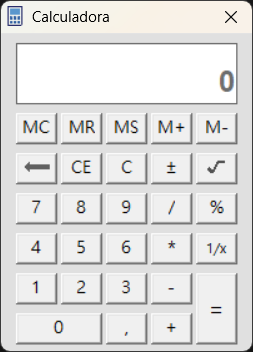
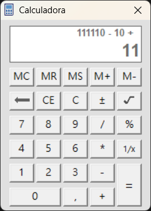
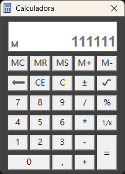

# VB6 Calculator

A classic desktop calculator built with Microsoft Visual Basic 6.0.

## Background

I created this project in 2021 while studying at Preuniversitario Raquel Pérez. It was my final project for validating the Visual Basic course taught in the 12th-grade computer science curriculum. This repository preserves the original Visual Basic project and its compiled Windows executable.

## Screenshots

### Light theme

### Operation history

### Dark theme

## Features

- Basic arithmetic: addition, subtraction, multiplication, and division.
- Square root, reciprocal, percentage, and sign-change operations.
- An expression display that shows the current operation.
- Memory controls: MC (clear), MR (recall), MS (store), M+ (add), and M− (subtract).
- Light and dark themes.
- Keyboard input for numbers and operators, backspace, clipboard actions, and memory controls.
- Error handling for division by zero and invalid square-root input.

## Run the application

### Use the included executable

On Windows, run `Calculadora.exe`.

### Open the Visual Basic project

1. Open `Calculadora.vbp` in the Visual Basic 6.0 IDE.
2. Press **F5** to run the project.
3. To build an executable, use **File > Make Calculadora.exe** in the IDE.

The project targets the classic 32-bit Visual Basic 6 runtime environment. Compatibility may vary on current Windows installations.

## Repository contents

- `Calculadora.vbp` — Visual Basic project file.
- `Calculadora.frm` and `Calculadora.frx` — form layout, source code, and form resources.
- `Calculadora.vbw` — Visual Basic workspace file.
- `Calculadora.exe` — compiled Windows application.
- `public/` — project screenshots.
- `LICENSE` — MIT License.

## License

This project is licensed under the [MIT License](LICENSE). Copyright © 2021 Angel Mario Roque Suárez.
